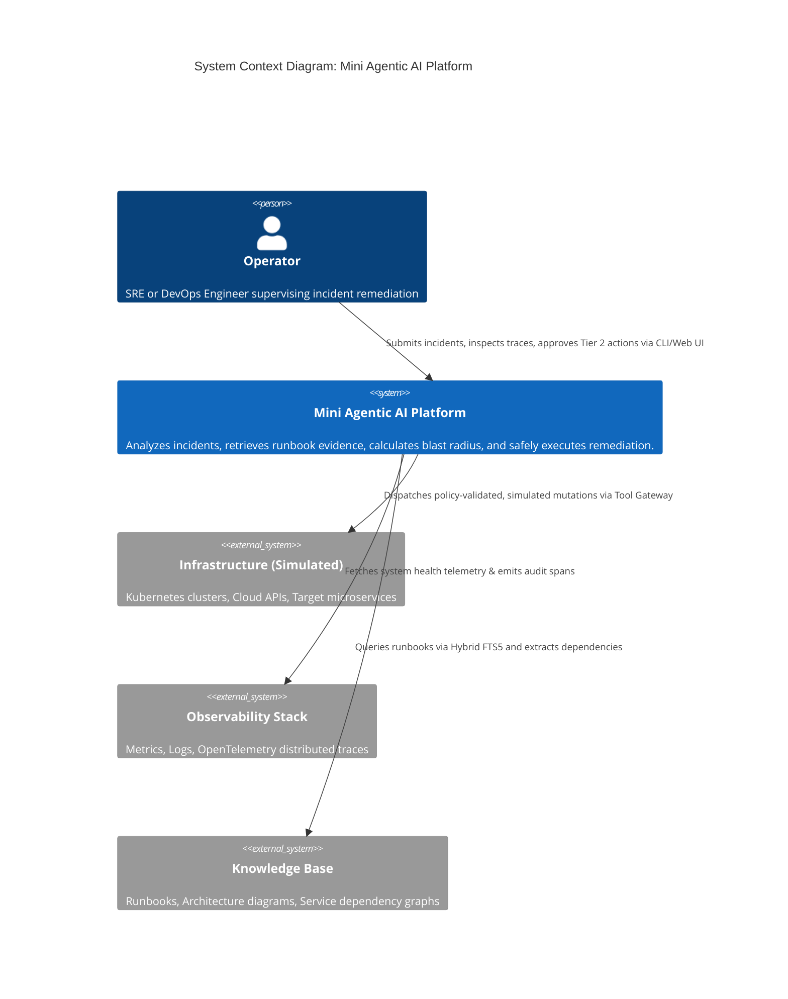
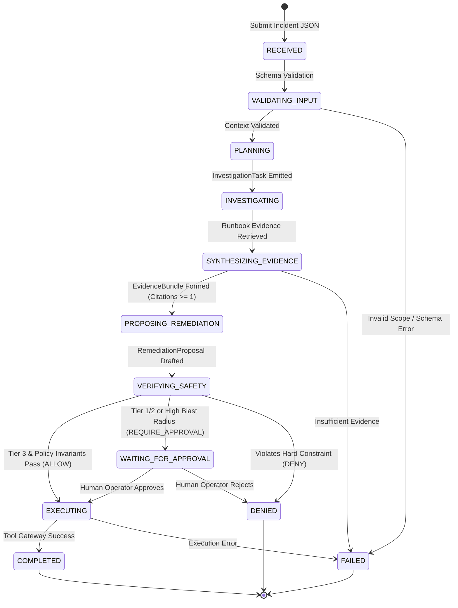

# 🤖 AgentOps: Mini Agentic AI Platform

> **A deterministic, bounds-checked agentic workflow platform for safe production incident analysis, automated root-cause investigation, and policy-gated remediation.**

[](https://www.python.org/downloads/)
[](https://docs.astral.sh/uv/)
[](https://github.com/langchain-ai/langgraph)
[](https://docs.pydantic.dev/)
[](https://docs.astral.sh/ruff/)
[](https://github.com/microsoft/pyright)
[](.github/workflows/ci.yml)
[](LICENSE)

---

## 📑 Table of Contents

- [Executive Summary](#-executive-summary)
- [The Problem: Why Naive AI Agents Fail in Production](#-the-problem-why-naive-ai-agents-fail-in-production)
- [Core Architectural Invariants](#-core-architectural-invariants)
- [System Architecture & Visual Diagrams](#-system-architecture--visual-diagrams)
  - [1. System Context Diagram (C4 Context)](#1-system-context-diagram-c4-context)
  - [2. Internal Container Diagram (C4 Container)](#2-internal-container-diagram-c4-container)
  - [3. Deterministic State Machine Flow](#3-deterministic-state-machine-flow)
  - [4. State Transition Matrix](#4-state-transition-matrix)
- [Separation of Duties & Agent Responsibilities](#-separation-of-duties--agent-responsibilities)
- [Autonomy Tiers & Deterministic Safety Gate](#-autonomy-tiers--deterministic-safety-gate)
- [Five-Minute Quick Start](#-five-minute-quick-start)
  - [Prerequisites](#1-prerequisites)
  - [Installation](#2-installation)
  - [Running the Offline Evaluation Suite](#3-run-the-offline-evaluation-suite)
  - [Running the Automated CLI Demo](#4-run-the-cli-demo)
  - [Launching the Interactive Web UI](#5-launch-the-interactive-web-ui)
  - [Inspecting the Audit Trail](#6-inspecting--replaying-audit-traces)
- [End-to-End Walkthrough: The `checkout-api` Incident](#-end-to-end-walkthrough-the-checkout-api-incident)
- [Repository & File Organization](#-repository--file-organization)
- [Testing & Quality Assurance Suite](#-testing--quality-assurance-suite)
- [CI/CD Pipeline & Rollback Strategy](#-cicd-pipeline--rollback-strategy)
- [Trade-offs & Production Hardening Roadmap](#-trade-offs--production-hardening-roadmap)
- [Documentation Hub & Deliverables Index](#-documentation-hub--deliverables-index)

---

## 🎯 Executive Summary

In high-stakes Site Reliability Engineering (SRE) and DevOps environments, executing remediation commands based on probabilistic LLM output is an unacceptable production risk. Unconstrained agent loops can trigger catastrophic cascading outages, hallucinate destructive commands, exceed resource quotas, or violate data sovereignty boundaries.

**AgentOps** is a production-grade, state-managed Mini Agentic AI Platform designed specifically to eliminate these hazards. It treats Large Language Models exclusively as **untrusted reasoning engines** that formulate hypotheses and propose structured actions. 

Every proposal is intercepted by a **zero-LLM, deterministic Python Policy Engine** that calculates knowledge-graph blast radiuses, validates hard organizational constraints, and enforces human-in-the-loop approval gates before any command can reach the execution gateway.

---

## ⚠️ The Problem: Why Naive AI Agents Fail in Production

| Naive Autonomous Agent Anti-Pattern | How AgentOps Solves It |
| :--- | :--- |
| **Open-Ended Chat Loops (ReAct / AutoGen)**: Agents loop unpredictably until context windows blow up or budgets drain. | **Strict LangGraph State Machine**: Deterministic transition table where agents only transition to allowed next states. |
| **Direct Tool Execution**: LLMs are given raw infrastructure SDKs or bash shells and directly trigger mutations. | **Sandboxed Tool Gateway**: LLMs generate versioned JSON proposals; the gateway validates tokens, idempotency, and environment scope. |
| **Probabilistic "LLM-as-a-Judge" Safety**: Using another LLM prompt to verify safety introduces the same hallucination risks. | **Zero-LLM Deterministic Verifier**: Hardcoded invariant rules (replica ceilings, blast radius thresholds, tier requirements). |
| **Unbounded Blast Radius**: Agents scale or restart services without knowing dependent downstream architectures. | **NetworkX Knowledge Graph**: Automatic BFS/DFS graph traversal to compute upstream and downstream blast radiuses. |
| **Unverifiable Black-Box Actions**: No auditable trace of why a model took a destructive action. | **Append-Only SQLite Event Log**: Every A2A envelope, hypothesis, and safety decision is preserved with causation IDs. |

---

## 🛡️ Core Architectural Invariants

AgentOps is built upon six non-negotiable architectural pillars:

1. **Deterministic State Machine**: Orchestrated via **LangGraph**, preventing unmonitored cycles and enforcing explicit terminal states (`COMPLETED`, `WAITING_FOR_APPROVAL`, `DENIED`, `FAILED`).
2. **Typed Agent-to-Agent (A2A) Envelopes**: Agents never exchange freeform markdown. All communication is strictly validated through **Pydantic v2** discriminated envelopes containing `schema_version`, `run_id`, `trace_id`, `correlation_id`, and `causation_id`.
3. **Zero-LLM Deterministic Safety Verifier**: Authorization decisions are computed via pure Python logic and declarative policies—guaranteeing that safety verification **fails closed** 100% of the time.
4. **Knowledge-Graph Dependency Analysis**: Upstream and downstream dependencies are traversed using an in-memory **NetworkX** directed graph to evaluate blast-radius severity (`low`, `medium`, `high`).
5. **Hybrid Evidence Retrieval**: Grounding hypotheses in verified facts via **SQLite FTS5** lexical search and vector similarity retrieval over versioned runbooks.
6. **Auditability & Replayability**: All workflow transitions and tool proposals are recorded in an append-only SQLite database, allowing compliance teams to reconstruct timelines without re-invoking models.

---

## 🏗️ System Architecture & Visual Diagrams

### 1. System Context Diagram (C4 Context)



### 2. Internal Container Diagram (C4 Container)

```mermaid
C4Container
    title Container Diagram: Platform Internals
    
    Container_Boundary(core, "AgentOps Core Platform") {
        Container(cli, "CLI & Web Dashboard", "Typer / FastAPI / Vanilla JS", "Operator management interface")
        Container(orchestrator, "Orchestrator Engine", "LangGraph / Python 3.12", "Enforces deterministic state transitions")
        
        Container_Boundary(agents, "Specialized Agent Layer") {
            Container(planner, "Planner Agent", "Pydantic + Prompt Contract", "Formulates scoped investigation objectives")
            Container(investigator, "Investigator Agent", "FTS5 + Semantic Retriever", "Retrieves evidence & forms cited hypotheses")
            Container(io_agent, "I&O Agent", "Pydantic Proposal Generator", "Drafts typed infrastructure remediation proposals")
            Container(verifier, "Safety Verifier", "Deterministic Rule Engine", "Zero-LLM fail-closed policy validation")
        }
        
        Container(tool_gateway, "Tool Gateway", "Python Sandbox", "Authenticates, verifies idempotency, executes simulated tools")
        
        ContainerDb(db, "Audit & Persistence", "SQLite / SQLAlchemy / FTS5", "Stores append-only event log & runbooks")
        ContainerDb(kg, "Knowledge Graph", "NetworkX (JSON-backed)", "Computes upstream & downstream blast radius")
    }
    
    Rel(cli, orchestrator, "Dispatches incident run request")
    Rel(orchestrator, agents, "Delegates subtasks via typed A2A messages")
    Rel(investigator, db, "FTS5 Lexical search on runbooks")
    Rel(io_agent, kg, "Queries graph reachability for blast radius")
    Rel(verifier, orchestrator, "Emits ALLOW / REQUIRE_APPROVAL / DENY")
    Rel(orchestrator, tool_gateway, "Invokes tool upon verification")
    Rel(orchestrator, db, "Appends immutable audit spans")
```

### 3. Deterministic State Machine Flow



### 4. State Transition Matrix

| Current State | Event / Input Trigger | Invariant Guard Condition | Next State |
| :--- | :--- | :--- | :--- |
| `RECEIVED` | Incident payload ingested | JSON conforms to `IncidentContext` | `VALIDATING_INPUT` |
| `VALIDATING_INPUT` | Scope verification | Tenant & Environment recognized | `PLANNING` |
| `PLANNING` | Planner decomposes intent | Objective formulated from allowlisted taxonomy | `INVESTIGATING` |
| `INVESTIGATING` | Evidence retrieval query | Runbooks found in FTS5/Semantic index | `SYNTHESIZING_EVIDENCE` |
| `SYNTHESIZING_EVIDENCE`| Hypothesis formulated | Minimum confidence & valid citation attached | `PROPOSING_REMEDIATION` |
| `PROPOSING_REMEDIATION`| Remediation drafted | Tool matches allowed catalog (`simulate_scale`, `simulate_restart`) | `VERIFYING_SAFETY` |
| `VERIFYING_SAFETY` | Deterministic policy run | Requested replicas > 100 | `DENIED` |
| `VERIFYING_SAFETY` | Deterministic policy run | Autonomy Tier < Required Tier | `WAITING_FOR_APPROVAL` |
| `VERIFYING_SAFETY` | Deterministic policy run | All invariants passed & Tier >= 3 | `EXECUTING` |
| `WAITING_FOR_APPROVAL` | Operator CLI/API approval | Valid approval signature provided | `EXECUTING` |
| `WAITING_FOR_APPROVAL` | Operator rejection | Operator clicks Deny / rejection timeout | `DENIED` |
| `EXECUTING` | Tool Gateway executes | Idempotency key verified; simulated tool runs | `COMPLETED` |

---

## 👥 Separation of Duties & Agent Responsibilities

To prevent prompt poisoning or unauthorized scope escalation, each agent in AgentOps adheres to a strict single-responsibility contract:

| Agent / Component | Type | Responsibility | Input Envelope | Output Envelope |
| :--- | :--- | :--- | :--- | :--- |
| **Planner Agent** | LLM / Contract | Deconstructs incident alerts into scoped tasks. Cannot propose tools or inspect data directly. | `IncidentContext` | `InvestigationTask` |
| **Investigator Agent** | Hybrid RAG | Queries lexical & semantic indices for runbooks. Must attach verifiable citations to hypotheses. | `InvestigationTask` | `EvidenceBundle` |
| **I&O Agent** | LLM / Logic | Synthesizes evidence to draft safe infrastructure proposals. Calculates blast radius via graph. | `EvidenceBundle` | `RemediationProposal` |
| **Safety Verifier** | **Deterministic Python** | Evaluates proposal parameters, hard ceilings, blast radius, and autonomy tiers. Zero LLM involvement. | `RemediationProposal` | `SafetyDecision` |
| **Tool Gateway** | Sandbox Sandbox | Validates idempotency keys, tenant isolation, and simulates infrastructure mutations. | Validated Proposal | `ExecutionResult` |
| **Orchestrator** | LangGraph Engine | Controls workflow state transitions and checkpoints state to disk. | `WorkflowState` | Streamed State Updates |

---

## ⚖️ Autonomy Tiers & Deterministic Safety Gate

AgentOps structures operations into three progressive **Autonomy Tiers**, guaranteeing that human oversight is automatically mandated for high-risk interventions:

```text
┌─────────────────────────────────────────────────────────────────────────┐
│                           AUTONOMY TIERS                                │
├─────────────────────────────────────────────────────────────────────────┤
│ Tier 1: Informational / Advisory Only                                   │
│   • Workflow halts after hypothesis synthesis.                          │
│   • All mutating proposals require explicit human approval.             │
├─────────────────────────────────────────────────────────────────────────┤
│ Tier 2: Semi-Autonomous with Human-in-the-Loop Gate (Default)           │
│   • Read-only operations and non-destructive diagnostics auto-execute.  │
│   • Mutating actions (scaling, restarts) pause at WAITING_FOR_APPROVAL. │
├─────────────────────────────────────────────────────────────────────────┤
│ Tier 3: Fully Autonomous Execution within Invariant Guards              │
│   • Mutating actions auto-execute ONLY IF:                              │
│       1. Target service matches allowlist.                              │
│       2. Target replicas <= 100 (hard ceiling).                         │
│       3. NetworkX blast radius is evaluated as "low" or "medium".       │
│   • Violations immediately route to DENIED.                             │
└─────────────────────────────────────────────────────────────────────────┘
```

---

## ⏱️ Five-Minute Quick Start

### 1. Prerequisites
- **Python 3.12+**
- **uv** (Astral's lightning-fast Python package installer):
  ```bash
  # Install uv if you don't already have it
  curl -LsSf https://astral.sh/uv/install.sh | sh
  ```

### 2. Installation
Clone the repository and install all dependencies via the root Makefile:
```bash
git clone https://github.com/Sreekarreddy2005/-IncidentGuard-AI-A-Multi-Agent-System-for-Incident-Diagnosis-and-Safe-Remediation.git
cd -IncidentGuard-AI-A-Multi-Agent-System-for-Incident-Diagnosis-and-Safe-Remediation
make install
```
*(Alternatively, run `uv sync` inside the `agentops` directory).*

### 3. Run the Offline Evaluation Suite
Verify that all deterministic state machine transitions, safety verifiers, and invariants pass without requiring live API keys:
```bash
make test
```
*Expected Output:*
```text
tests/evaluation/test_trajectory.py .. [100%]
============================== 2 passed in 0.35s ===============================
```

### 4. Run the CLI Demo
Execute a complete end-to-end incident investigation and remediation simulation in your terminal:
```bash
make demo
```
*(Or execute `./agentops/demo.sh` directly).*

### 5. Launch the Interactive Web UI
Start the FastAPI server and open the visual incident control dashboard:
```bash
make serve
```
Open **[http://localhost:8000](http://localhost:8000)** in your browser. You will see the real-time agent workflow execution panel, live state transitions, and audit trail visualizer.

### 6. Inspecting & Replaying Audit Traces
Every workflow execution logs an immutable trace to SQLite. To view the complete audit timeline for any run:
```bash
cd agentops
uv run agentops trace-show <run-id>
```

---

## 🔬 End-to-End Walkthrough: The `checkout-api` Incident

Let's trace how AgentOps handles a real-world production alert (`examples/incidents/checkout-api.json`):

### The Incident Payload:
```json
{
    "incident_id": "INC-20260923-001",
    "tenant_id": "t-acme-corp",
    "environment": "production",
    "service": "checkout-api",
    "description": "High latency and 5xx errors reported on checkout API. Customers unable to complete purchases.",
    "requested_autonomy_tier": 2
}
```

### The 6-Step Execution Lifecycle:

```text
1. [receive]     -> VALIDATING_INPUT
   Validates tenant scope, environment ('production'), and loads initial state.

2. [planner]     -> INVESTIGATING
   Emits InvestigationTask: "Investigate High latency and 5xx errors on checkout-api".

3. [investigator]-> SYNTHESIZING_EVIDENCE
   Queries SQLite FTS5 for runbooks matching 'checkout-api'. Retrieves runbook 'rb-checkout-5xx'
   Cites: "When checkout-api experiences >5% 5xx errors, scale replicas by 50% up to 50 max."
   Confidence: 0.85.

4. [io_agent]    -> PROPOSING_REMEDIATION
   Traverses NetworkX dependency graph: checkout-api -> payment-gateway, inventory-db.
   Blast radius evaluated as: 'medium'.
   Drafts RemediationProposal: action='simulate_scale', service='checkout-api', replicas=50.

5. [verifier]    -> VERIFYING_SAFETY
   Evaluates invariants:
   ✓ replicas (50) <= max_replicas (100) -> PASS
   ✓ Autonomy Tier 2 allows simulation under configured threshold -> ALLOW
   Emits SafetyDecision: decision='ALLOW', reason='POLICY_PASSED'.

6. [execute]     -> COMPLETED
   Tool Gateway executes simulated scale with idempotency token 'f3090414-478c...'.
   ExecutionResult: "Simulated scale of checkout-api to 50 replicas successful."
```

---

## 📂 Repository & File Organization

```text
Mini Agentic AI Platform/
├── Makefile                          # Top-level Makefile forwarding commands to agentops
├── README.md                         # Comprehensive architecture & operator manual
├── .gitignore                        # Workspace ignore rules
├── docs/                             # Architecture Decision Records & Deliverables
│   ├── 01-architecture.md            # In-depth system architecture & C4 diagrams
│   ├── 02-user-flow.md               # Operator workflows, state diagrams & CLI specifications
│   ├── 03-architecture-decisions.md  # Formal Architectural Decision Records (ADR-001 to 009)
│   ├── 04-implementation-plan.md     # Risk-ordered milestones & Definition of Done
│   ├── trade-offs.md                 # Prototype simplifications vs production hardening
│   └── demo-script.md                # Structured presentation walkthrough script
│
└── agentops/                         # Core Python package
    ├── pyproject.toml                # Project configuration, dependencies & CLI entrypoints
    ├── uv.lock                       # Cryptographically locked dependency tree
    ├── Makefile                      # Tooling targets (install, format, lint, typecheck, test, demo)
    ├── demo.sh                       # Executable bash demo automation script
    ├── .env.example                  # Safe configuration defaults with no exposed secrets
    │
    ├── src/agentops/
    │   ├── domain/                   # Pure Pydantic v2 domain schemas
    │   │   ├── messages.py           # Typed A2A envelopes (InvestigationTask, Proposal, etc.)
    │   │   └── state.py              # LangGraph TypedDict workflow state contract
    │   ├── agents/                   # Agent implementations
    │   │   ├── planner.py            # Converts raw alerts into scoped tasks
    │   │   ├── investigator.py       # Retrieves runbooks & forms cited hypotheses
    │   │   └── io_agent.py           # Drafts infrastructure proposals & queries graph
    │   ├── orchestration/
    │   │   └── graph.py              # LangGraph state machine & conditional routing
    │   ├── policies/
    │   │   └── verifier.py           # Deterministic Python policy engine (Zero LLM)
    │   ├── knowledge_graph/
    │   │   └── graph.py              # NetworkX graph for blast radius BFS/DFS calculation
    │   ├── retrieval/
    │   │   └── hybrid.py             # SQLite FTS5 lexical retriever with schema isolation
    │   ├── tools/
    │   │   └── gateway.py            # Sandboxed Tool Gateway with idempotency checks
    │   ├── persistence/
    │   │   └── sqlite.py             # SQLAlchemy models for append-only audit event log
    │   ├── observability/
    │   │   └── tracer.py             # OpenTelemetry-compatible tracing & PII redaction
    │   ├── cli/
    │   │   └── main.py               # Typer CLI ('incident-run', 'trace-show')
    │   └── api/
    │       ├── server.py             # FastAPI REST endpoints
    │       └── static/               # Interactive Web Dashboard (HTML/CSS/JS)
    │
    ├── tests/
    │   ├── evaluation/
    │   │   └── test_trajectory.py   # Deterministic trajectory & invariant tests
    │   ├── unit/                     # Domain & policy unit tests
    │   ├── integration/              # Database & retriever integration tests
    │   └── contract/                 # Schema & envelope compliance tests
    │
    └── examples/
        ├── incidents/                # Sample incident payloads (checkout-api.json)
        └── knowledge/                # Seed runbooks (runbooks.json) & topology (dependencies.json)
```

---

## 🧪 Testing & Quality Assurance Suite

AgentOps enforces strict engineering standards through automated Makefile targets:

```bash
# Run code formatter
make format

# Run linter checks (Ruff)
make lint

# Run strict static type checking (Pyright)
make typecheck

# Run offline evaluation harness
make test

# Run entire verification suite (format + lint + test + typecheck)
make check
```

### Invariant Trajectory Testing
Unlike standard software tests that only test unit methods, our evaluation suite (`tests/evaluation/test_trajectory.py`) verifies entire agent trajectories:
1. **Golden Autonomous Path (`test_golden_trajectory_autonomous_allow`)**: Verifies that a valid Tier 3 incident traverses all nodes and cleanly completes.
2. **Approval-Required Gate (`test_trajectory_requires_approval`)**: Verifies that a Tier 1 or Tier 2 incident halts at `WAITING_FOR_APPROVAL` without invoking the Tool Gateway.

---

## 🚀 CI/CD Pipeline & Rollback Strategy

### CI Pipeline
Every Pull Request triggers our GitHub Actions pipeline (`.github/workflows/ci.yml`), which executes:
1. Dependency synchronization via `uv sync`.
2. Code formatting verification (`ruff format --check`).
3. Strict linting analysis (`ruff check`).
4. Type safety analysis (`pyright`).
5. Offline trajectory evaluation tests (`pytest tests/evaluation -v`).

### Rollback Strategy
AgentOps is engineered with forward-only schema migrations and zero-downtime rollbacks in mind:
- **Code Rollback**: State is exchanged through versioned Pydantic messages. If a new agent version introduces an issue, rolling back simply requires reverting the Git SHA. Older agents safely ignore optional newer fields without breaking.
- **Audit Trail Recovery**: The SQLite `event_log` is strictly append-only. If a policy executes incorrectly, operators can audit the exact historical decision points using `uv run agentops trace-show <run-id>` and re-run deterministic replays.

---

## 🔍 Trade-offs & Production Hardening Roadmap

Building this prototype within a focused timebox required conscious architectural trade-offs:

| Component | Prototype Implementation | Production Hardening Architecture |
| :--- | :--- | :--- |
| **Model Gateway** | Deterministic Pydantic Fake Model | Real LLM SDKs (OpenAI / Claude / Gemini) with LLM-as-a-Judge evaluations (LangSmith / Braintrust). |
| **Persistence** | Zero-infra local SQLite file (`agentops.db`) | Managed PostgreSQL with read replicas & partitioned audit tables. |
| **Retrieval Engine** | SQLite FTS5 Lexical Search | Dedicated Vector Database (Qdrant / Milvus) + Reciprocal Rank Fusion (RRF). |
| **Knowledge Graph** | In-Memory NetworkX from JSON | Enterprise Graph Database (Neo4j / Amazon Neptune). |
| **Human-in-the-Loop** | CLI / Web UI Approval token | Interactive Slack / Microsoft Teams Webhook cards for on-call engineers. |
| **Tool Execution** | Mock Python Sandbox with Idempotency | Out-of-process Model Context Protocol (MCP) servers with mTLS & Kubernetes RBAC. |

*(For full details, review [docs/trade-offs.md](docs/trade-offs.md)).*

---

## 📚 Documentation Hub & Deliverables Index

Detailed engineering documentation is organized inside the `docs/` folder:

- 📐 **[docs/01-architecture.md](docs/01-architecture.md)** — In-depth architectural specification, trust boundaries, and C4 diagrams.
- 🔄 **[docs/02-user-flow.md](docs/02-user-flow.md)** — Sequence diagrams, operator user flows, and state diagrams.
- 📋 **[docs/03-architecture-decisions.md](docs/03-architecture-decisions.md)** — Complete Architectural Decision Records (ADR-001 through ADR-009).
- 🗺️ **[docs/04-implementation-plan.md](docs/04-implementation-plan.md)** — Milestone delivery plan, risk ordering, and Definition of Done.
- ⚖️ **[docs/trade-offs.md](docs/trade-offs.md)** — Prototype simplifications vs. production hardening strategies.
- 🎙️ **[docs/demo-script.md](docs/demo-script.md)** — Comprehensive presentation guide and walkthrough script for video/live demos.

---

## 📄 License
This project is licensed under the MIT License. See [LICENSE](LICENSE) for details.
